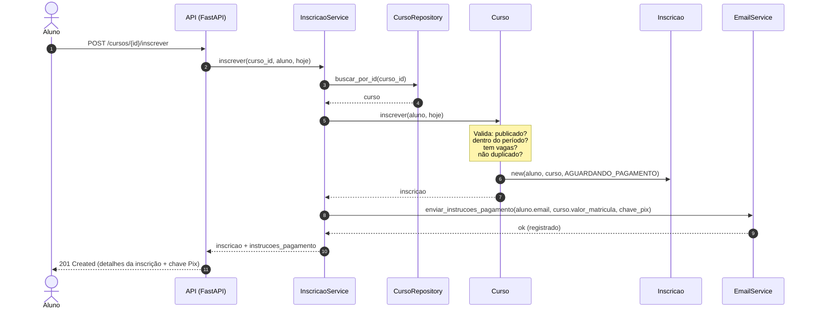
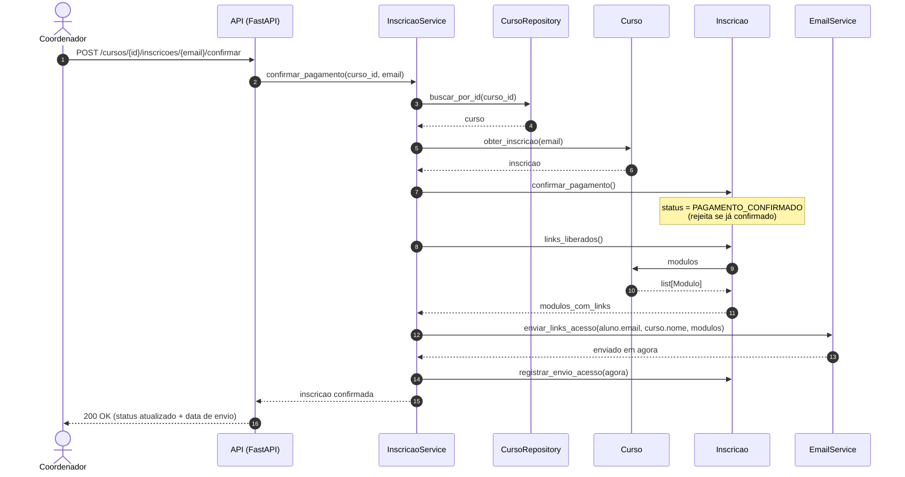

# Passo 4 — Desenhar a conversa entre os objetos

[← Passo 3](03-responsabilidades.md) · [Projeto da v1](README.md) · próximo: [Passo 5 — Montar as camadas](05-aplicacao-fastapi.md)

Como as classes colaboram para realizar as histórias de usuário que envolvem mais de um objeto e serviços externos (e-mail).

---

## 1. US-07: Aluno se inscreve em curso

Na inscrição, o aluno solicita vaga no curso. O serviço consulta o curso, delega a criação da inscrição respeitando as regras do domínio (vagas, período e duplicidade), persiste o estado e dispara o e-mail com as instruções de pagamento (D-01, RN-01.1).

---

## 2. US-08: Coordenador confirma pagamento e libera acesso

O pagamento ocorre fora do sistema (Pix). O coordenador aciona a confirmação na API. O serviço executa a transição de estado da inscrição no domínio, envia o e-mail contendo os links de todos os módulos vigentes (D-03, D-04) e registra a data/hora exata do envio na inscrição (RN-02.5), eliminando o controle manual em planilha/Gmail.

